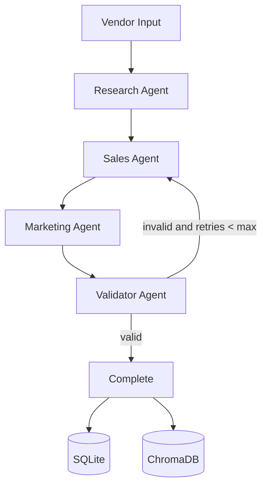

# 🤖 FromNear AI Employee

AI-powered assistant for vendor research, personalized sales outreach, and campaign generation.

## Overview

FromNear runs a deterministic multi-agent pipeline:

1. **Research Agent** collects website/Instagram context.
2. **Sales Agent** drafts personalized outreach using current context + memory.
3. **Marketing Agent** creates campaign content.
4. **Validator Agent** applies deterministic checks and retries when needed.

Outputs are persisted in:
- **SQLite** (vendor data + run history)
- **ChromaDB** (vector memory for recall)

---

## Architecture Flow



---

## Tech Stack

- **Backend:** FastAPI, LangGraph, SQLAlchemy, ChromaDB
- **Frontend:** React, TypeScript, Vite, React Query
- **LLM Runtime:** OpenAI-compatible endpoint (Ollama recommended)
- **Infra:** Docker Compose

---

## Repository Structure

```text
FromNear-AI-Employee/
├── backend/
│   ├── app/
│   │   ├── agents/
│   │   ├── orchestrator/
│   │   ├── routes/
│   │   ├── memory/
│   │   ├── schemas/
│   │   ├── tools/
│   │   └── tests/
│   ├── .env.example
│   ├── pyproject.toml
│   └── requirements.txt
├── frontend/
│   ├── src/
│   │   ├── api/
│   │   ├── layouts/
│   │   ├── pages/
│   │   └── router/
│   ├── .env.example
│   └── package.json
├── docs/
│   ├── architecture.md
│   └── configuration.md
└── docker-compose.yml
```

---

## Prerequisites

- **Python:** 3.11+
- **Node.js:** 18+
- **npm:** latest stable
- **Ollama** (recommended for local model hosting) or another OpenAI-compatible endpoint
- **Docker** + **Docker Compose** (optional for containerized setup)

---

## Environment Configuration

### Backend (`backend/.env`)

Copy from example and update values:

```bash
cd backend
cp .env.example .env
```

Required variables:

```env
LLM_BASE_URL=http://localhost:11434/v1
CHAT_MODEL=llama3.2
EMBED_MODEL=nomic-embed-text
DATABASE_URL=sqlite+aiosqlite:///./data.db
VECTOR_STORE_PATH=./vector_store
CORS_ORIGINS=http://localhost:5173
```

Optional:

```env
MAX_RETRIES=2
MIN_CAMPAIGN_POSTS=5
```

### Frontend (`frontend/.env`)

```bash
cd frontend
cp .env.example .env
```

```env
VITE_API_BASE_URL=http://localhost:8000
```

---

## Local Development Setup

### 1) Backend

```bash
cd backend
python -m venv .venv
source .venv/bin/activate   # Windows: .venv\Scripts\activate
pip install -r requirements.txt
uvicorn app.main:app --reload --host 127.0.0.1 --port 8000
```

Backend URLs:
- API root: `http://localhost:8000/`
- Swagger docs: `http://localhost:8000/docs`
- Health: `http://localhost:8000/api/v1/health`

### 2) Frontend

```bash
cd frontend
npm install
npm run dev
```

Frontend URL:
- App: `http://localhost:5173`

---

## API Endpoints (Mounted at `/api/v1`)

| Method | Endpoint | Description |
|---|---|---|
| GET | `/health` | Service health check |
| POST | `/vendors/run` | Run full pipeline for a vendor |
| GET | `/vendors` | List vendors |
| GET | `/vendors/{vendor_id}` | Vendor detail |
| GET | `/vendors/{vendor_id}/run` | Last run artifacts |
| POST | `/vendors/{vendor_id}/followup` | Generate follow-up pitch |
| GET | `/vendors/{vendor_id}/history` | Interaction history |

---

## CLI Cheat Sheet

### Frontend

```bash
cd frontend
npm install
npm run dev
npm run lint
npm run build
npm run preview
```

### Backend

```bash
cd backend
pip install -r requirements.txt
ruff check .
PYTHONPATH=. pytest
uvicorn app.main:app --reload --host 127.0.0.1 --port 8000
```

### Docker

```bash
docker-compose up --build -d
docker-compose logs -f backend
docker-compose down
```

---

## Docker Deployment

```bash
docker-compose up --build -d
```

Containers:
- `fromnear_backend` → `http://localhost:8000`
- `fromnear_frontend` → `http://localhost:80`

---

## Troubleshooting

- **Backend cannot start:** ensure `backend/.env` exists and required variables are set.
- **CORS errors in browser:** verify `CORS_ORIGINS` matches frontend host/port.
- **Frontend cannot reach API:** verify `VITE_API_BASE_URL` in `frontend/.env`.
- **Model errors:** verify your chat/embedding models are available in your LLM runtime.

---

## Additional Documentation

- `docs/architecture.md`
- `docs/configuration.md`

---

## License

MIT
